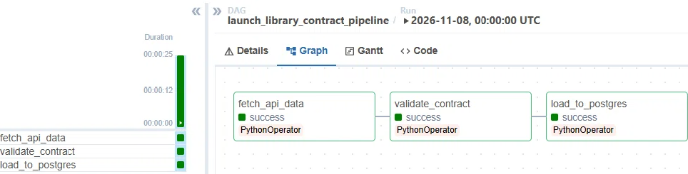
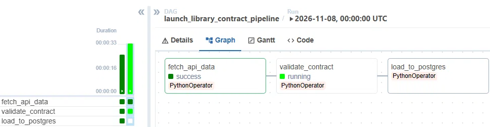
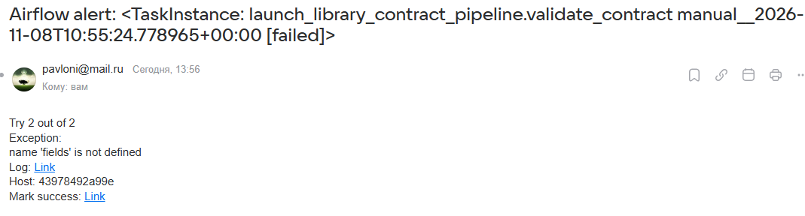
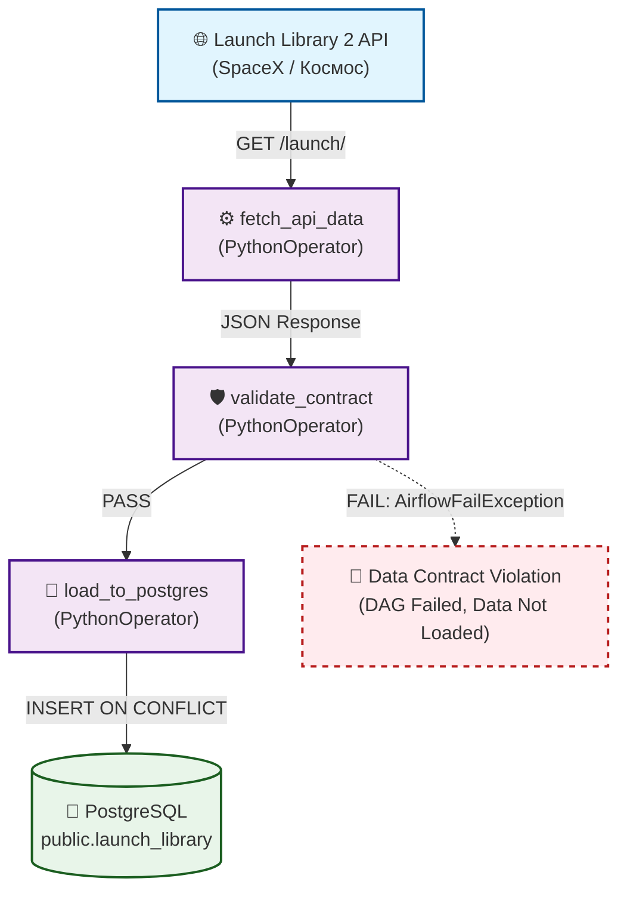

# 🛡 API Data Contracts Pipeline

Pet-проект: E2E-пайплайн с валидацией внешнего API по **Data Contracts**. Демонстрирует подход к защите DWH от неожиданных изменений структуры данных со стороны источника.

## 📸 Скриншоты

**Успешный сценарий:** данные прошли валидацию и загружены в PostgreSQL.



**Негативный сценарий (Data Contract Violation):** API прислал битые данные, контракт поймал ошибку, пайплайн упал, данные в БД не попали.



При нарушении контракта Airflow падает и отправляет Email-алерт (настроен SMTP Mail.ru)



## 🎯 Зачем это

Внешние API часто меняются: переименовывают поля, меняют типы данных или начинают присылать `null` там, где раньше были числа. Если загружать такие данные в DWH «как есть», витрины и дашборды ломаются.

Этот проект показывает, как внедрить **Data Contracts** (контракты данных) в ETL-процесс:
1. Перед загрузкой в БД данные проверяются по YAML-контракту.
2. Если структура или типы не совпадают — пайплайн падает с ошибкой (`AirflowFailException`).
3. В базу попадают только валидные данные.

## 🏗 Архитектура



## 📂 Структура

```
api-data-contracts/
├── contracts/
│   └── launch_library.yml       # YAML-описание ожидаемой структуры API
├── dags/
│   └── launch_library_contract_dag.py # DAG для Airflow
├── scripts/
│   └── api_contract_validator.py      # Валидатор JSON по YAML
├── data/
│   └── sample.json                    # Пример ответа API для локальной проверки
├── assets/                            # Скриншоты для README
├── README.md
└── requirements.txt
```

## 🚀 Запуск

### 1. Зависимости
```bash
pip install -r requirements.txt
```

### 2. Локальная проверка валидатора
Скачай пример ответа API и проверь его по контракту:
```bash
python -c "import requests, json; r = requests.get('https://ll.thespacedevs.com/2.2.0/launch/?limit=5'); open('data/sample.json','w').write(json.dumps(r.json()))"
python scripts/api_contract_validator.py data/sample.json
```
Ожидаемый вывод: `[OK] Contract passed`.

### 3. Интеграция с Airflow
1. Скопируй проект в VM.
2. В `docker-compose.yml` добавь монтирование папки проекта в контейнер:
   ```yaml
   volumes:
     - /home/pavel/api-data-contracts:/opt/airflow/project
   environment:
     PYTHONPATH: /home/airflow/.local/lib/python3.11/site-packages:/opt/airflow/project/scripts
   ```
3. Скопируй DAG в папку `dags` Airflow:
   ```bash
   cp dags/launch_library_contract_dag.py ~/airflow/standalone/dags/
   ```
4. Перезапусти Airflow:
   ```bash
   sudo docker compose down && sudo docker compose up -d
   ```
5. В UI Airflow (порт 8081) найди DAG `launch_library_contract_pipeline` и запусти его.

## 🔍 Негативный сценарий (Data Quality)

В README приведены два скриншота:
1. **Успешный запуск** — все 3 задачи зеленые.
2. **Падение валидатора** — задача `validate_contract` красная, `load_to_postgres` не запустилась. Это доказывает, что контракт защищает базу от битых данных.

Чтобы воспроизвести негативный сценарий, можно добавить в валидатор код:
```python
if item.get("probability") is not None:
    item["probability"] = "99.9"  # Эмуляция бага: число превратилось в строку
```
После этого DAG упадет на шаге валидации, а данные в БД не изменятся.

## 🛠 Стек

- **Python** — requests, psycopg2, PyYAML
- **Apache Airflow** — оркестрация пайплайна
- **PostgreSQL** — целевое хранилище
- **Docker / Docker Compose** — запуск Airflow в изолированной среде

## 📊 Результат

- Валидатор проверяет **все 50 записей** из API.
- Обрабатываются поля верхнего уровня и вложенные объекты (`status`, `launch_service_provider`).
- Данные успешно загружаются в `public.launch_library` (с обновлением по `ON CONFLICT`).
- В случае нарушения контракта — пайплайн останавливается, данные в DWH не попадают.

## 🔗 Связанные проекты

- [`data-governance-platform`](https://github.com/nconichtchenko-arch/data-governance-platform) — валидатор таблиц БД по YAML-контрактам.
- [`airflow-e2e-api-pipeline`](https://github.com/nconichtchenko-arch/airflow-e2e-api-pipeline) — базовый E2E пайплайн (курсы валют).
- [`data-contracts-demo`](https://github.com/nconichtchenko-arch/data-contracts-demo) — базовый Data Contracts.

## 📫 Контакты

- **GitHub:** [github.com/nconichtchenko-arch](https://github.com/nconichtchenko-arch)
- **Email:** pavloni@mail.ru
- **Формат работы:** удалённо
